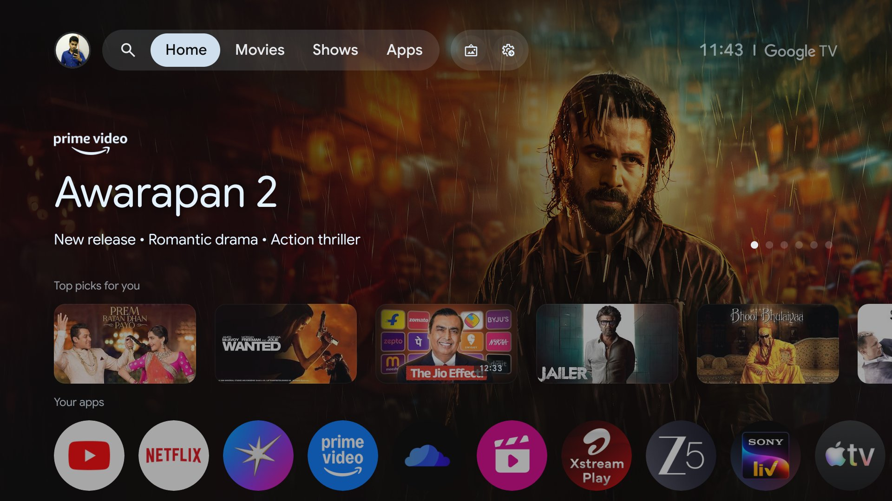
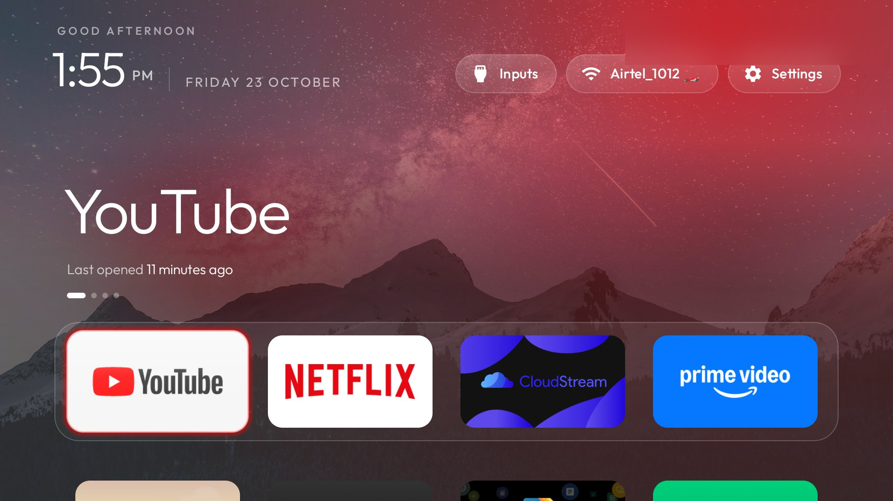

# tv-revamp

I built **tv-revamp** to take back the home screen on Android TV and Google TV: strip the sponsored rows and preloads I do not want, sideload a launcher I actually enjoy, and swap themes without rebuilding an APK. Everything goes over Wi-Fi from a laptop and a coding assistant. Packages are **disabled**, not uninstalled, so one restore script can bring the stock experience back. No root and no cable.

Along the way I added themes (including seasonal skins and rotating wallpaper collections), a privacy audit for installed apps, Perfetto tracing helpers, and a long troubleshooting guide from real TVs. The launcher stays small (under 480 KB), runs on 1 GB RAM sets, and never asks for network permission.

## Before and after

Screens from my own TV while I was putting this together — your model and firmware will differ:

| Before (stock Google TV home) | After (tv-revamp launcher) |
|---|---|
|  |  |

## How it works

| Step | What happens |
|---|---|
| **Back up** | Installed packages and settings are saved locally under `backup/`. |
| **Disable** | Telemetry, ad surfaces, and bloat you do not need are turned off with `pm disable-user --user 0`. |
| **Install** | The launcher APK is sideloaded and set as Home. |

`tools/disable.sh` and `tools/restore.sh` enforce guardrails I rely on: core Android packages, Live TV, HDMI inputs, Play Store, and the keyboard stay enabled unless you explicitly choose otherwise.

## Supported platforms

| Platform | What works |
|---|---|
| **Android TV, Google TV** | Debloat and launcher. |
| **Fire TV** | Debloat only; Fire OS does not hand Home to a third-party launcher. |
| **Samsung (Tizen), LG (webOS)** | Not Android; this repo does not apply. |

Which packages are safe to disable depends on brand and firmware. I use [PROMPT.md](PROMPT.md) with an assistant on the actual TV so the list matches what is installed, not a generic template.

## Quick start

You need a computer on the same Wi-Fi as the TV (or [Tailscale](docs/REMOTE.md)) and a coding assistant with shell access.

1. On the TV: Settings → Device Preferences → About → press **Build** seven times → Developer options → **USB debugging** on (and wireless/network ADB if shown).
2. On your computer: open [PROMPT.md](PROMPT.md), paste it into your assistant, and set your TV model.
3. Accept the USB debugging prompt on the TV and answer the checklist (apps you use, dock, voice assistant, updates).

With this repo as context, my first run on a new set is usually about fifteen minutes. I verify steps with TV screenshots (`tools/tv.py --screenshot`).

When you are finished, turn USB and network debugging off and run `tools/adb-closed.py` so port 5555 is not left open on the LAN.

## What you get

- A dark home screen with a dock of favourite apps, a top shelf for the focused app, and a grid of everything else.
- Inputs, network, and Settings in the top bar; optional themes via `tools/theme.sh` ([themes/README.md](themes/README.md)).
- Module cards from separate apps ([docs/modules.md](docs/modules.md)) if you sideload a module APK or build your own.

## Tools

| Tool | What it does |
|---|---|
| [`tools/tv.py`](tools/tv.py) | ADB shell, screenshots, probe |
| [`tools/disable.sh`](tools/disable.sh) | Apply a debloat list safely |
| [`tools/restore.sh`](tools/restore.sh) | Re-enable disabled packages |
| [`tools/theme.sh`](tools/theme.sh) | Push a theme folder |
| [`tools/check.py`](tools/check.py) | Validate a list before or after apply |
| [`tools/recovery.py`](tools/recovery.py) | Handover recovery records |
| [`tools/adb-closed.py`](tools/adb-closed.py) | Verify ADB port is closed |
| [`tools/bench.py`](tools/bench.py) | Optional launcher performance samples |
| [`tools/privacy.py`](tools/privacy.py) | Heuristic privacy audit of installed packages |
| [`tools/relay.py`](tools/relay.py) | Local relay when the agent cannot reach the TV |
| [`tools/b64push.py`](tools/b64push.py) | Push large files when ADB install hangs |
| [`tools/trace.py`](tools/trace.py) | Record Perfetto traces ([tools/trace.md](tools/trace.md)) |
| [`tools/trace_report.py`](tools/trace_report.py) | Summarize trace files |
| [`tools/flamechart.py`](tools/flamechart.py) | Flame charts from traces |
| [`tools/screendiff.py`](tools/screendiff.py) | Compare TV screenshots |
| [`tools/race_calendar.py`](tools/race_calendar.py) | Optional race-calendar module data |
| [`launcher/build-and-install.sh`](launcher/build-and-install.sh) | Build and install the launcher |

See each file’s header comment for usage. Agents: [AGENTS.md](AGENTS.md).

[`tools/privacy.py`](tools/privacy.py) groups packages by name and permission heuristics. What the audit cannot do is prove intent: a row in the report is a hint to read `dumpsys package`, not a verdict to disable blindly.

## My reference TV

I keep notes for one unit at home as an example — you do not need to match it:

- [CHANGE.md](CHANGE.md) — packages I disabled on that TV  
- [UNDO.md](UNDO.md) and [undo.sh](undo.sh) — restore stock Home on that unit  
- [TV-README.md](TV-README.md) — theme and day-to-day notes for that set  
- [REDO-PROMPT.md](REDO-PROMPT.md) — repeat the same procedure on that unit  

`backup/`, `shots/`, and `work/` are gitignored session data.

## The launcher

A native home screen for Android TV and Google TV: plain Java, no network permission, tuned for 1 GB RAM TVs.

The **TV** needs Android 8.0 (API 26) or newer: `minSdk` is set in [`launcher/app/build.gradle`](launcher/app/build.gradle), and the install script reads `ro.build.version.sdk` before building so an older set fails fast instead of at `pm install` (see [docs/TROUBLESHOOTING.md](docs/TROUBLESHOOTING.md) for what still works on such a set).

Themes live in [`themes/`](themes/). Module cards are documented in [docs/modules.md](docs/modules.md). Any Android TV app that declares the module contract can show up as a dock card after the owner approves it.

<b>Launcher settings and the default home</b>

- Click **Settings** for the TV's own settings. Hold OK on it and choose **Launcher settings**, or click it
  straight away with `launcher_settings_button`. The launcher's own page has these rows, top to bottom:
  - **Reorder apps**, only with `launcher_settings_button`: OK picks an app up, the arrows move it, Back
    places it, and Back again finishes.
  - **Apps per row** 4, 5, 6 or 7; **Rows below dock** 0 to 3, how many rows of tiles stay visible under the
    dock band; **Dock band opacity** 100%, 70%, 50% or 30%. The last two only do anything while the dock is
    its own row (`dock_row`, on by default).
  - **Wallpaper**: one picture from the theme's collection (or its `wallpaper.jpg`), **None**, or **Theme
    default**. A pick holds that picture and stops the rotation until you choose Theme default, press
    Follow theme, or push the theme again.
  - **Animations** on or off, and **Advanced effects** (tile lift, icon zoom and smooth ambient-colour
    transitions; they may use more memory) once animations are on.
  - **Follow theme (reset on-TV choices)**, which clears every choice above. Pushing or resetting a theme
    clears them too.
  - **Choose default home** opens Android's home picker, and **TV system settings** the TV's own settings
    page.
- **Change the default home:** Launcher settings and the optional Default-home tile
  (`show_home_settings_shortcut`) open Android's home picker. Choose the original launcher to stop using
  tv-revamp as Home, or the custom launcher to return. The original launcher must be enabled; if the install
  script disabled it, run `tools/restore.sh` first. Some TVs provide no home picker.

## Docs

- [docs/TROUBLESHOOTING.md](docs/TROUBLESHOOTING.md) — ADB and launcher issues I have hit on real sets  
- [docs/REMOTE.md](docs/REMOTE.md) — work on a TV over Tailscale  
- [docs/workflows/perf-ab.md](docs/workflows/perf-ab.md) — optional launcher performance checks  

## License

MIT — see [LICENSE](LICENSE). Launcher font: Outfit (SIL OFL), see [launcher/FONT-LICENSE-OFL.txt](launcher/FONT-LICENSE-OFL.txt).
